# 01 — Kiến trúc hệ thống (Architecture)

## 1. Sơ đồ các tầng kiến trúc (Layered Architecture)

Hệ thống ARIA được thiết kế theo mô hình kiến trúc phân tầng phân tách độc lập giữa Presentation Layer (Next.js), Application & AI/Optimization Layer (FastAPI) và Persistence & Realtime Layer (Supabase PostGIS).

```mermaid
flowchart TD
    subgraph Client["Presentation Layer (Next.js 14 / TypeScript)"]
        UI_Plan["Plan Wizard Page<br/>frontend/src/app/plan/page.tsx"]
        UI_Trip["Trip Detail & Replanner<br/>frontend/src/app/trips/[id]/page.tsx"]
        MapComp["Leaflet Interactive Map<br/>frontend/src/components/map/MapView.tsx"]
        TimelineComp["Day Timeline Component<br/>frontend/src/components/timeline/DayTimeline.tsx"]
        ApiClient["REST API Client<br/>frontend/src/lib/api.ts"]
        SupaClient["Supabase Realtime Client<br/>frontend/src/lib/supabase.ts"]
    end

    subgraph Server["API & Intelligence Layer (FastAPI / Python 3.12)"]
        RouterMain["Main Router<br/>backend/app/main.py"]
        RouterTrips["Trips Router<br/>backend/app/routers/trips.py"]
        RouterPOIs["POIs Router<br/>backend/app/routers/pois.py"]
        RouterWeather["Weather Router<br/>backend/app/routers/weather.py"]

        SvcAI["AI Intent & Scoring<br/>backend/app/services/ai_agent.py"]
        SvcOpt["OR-Tools TSPTW Optimizer<br/>backend/app/services/optimizer.py"]
        SvcCluster["K-Means Clusterer<br/>backend/app/services/clusterer.py"]
        SvcReplan["Adaptive Replanner Engine<br/>backend/app/services/replanner.py"]
        SvcRoute["OSRM / Haversine Routing<br/>backend/app/services/routing.py"]
        SvcWeather["Weather Service<br/>backend/app/services/weather.py"]
        GeoHelper["PostGIS EWKB Parser<br/>backend/app/core/geo.py"]
    end

    subgraph Data["Persistence & Storage Layer (Supabase Cloud)"]
        Postgres["PostgreSQL 15 Engine<br/>supabase/migrations/20261023000000_init_schema.sql"]
        PostGIS["PostGIS Spatial Extension (SRID 4326)"]
        SupaRT["Supabase Realtime Engine (WebSocket)"]
    end

    subgraph External["External Cloud APIs"]
        Groq["Groq Cloud LLM (openai/gpt-oss-120b)"]
        OpenRouter["OpenRouter LLM Fallback"]
        OWM["OpenWeatherMap API"]
        OSRM["OSRM Public Routing API"]
    end

    UI_Plan --> ApiClient
    UI_Trip --> ApiClient
    UI_Trip --> SupaClient
    ApiClient -->|HTTP REST| RouterMain
    RouterMain --> RouterTrips
    RouterMain --> RouterPOIs
    RouterMain --> RouterWeather

    RouterTrips --> SvcAI
    RouterTrips --> SvcOpt
    RouterTrips --> SvcReplan
    RouterTrips --> SvcRoute

    SvcOpt --> SvcCluster
    SvcAI --> Groq
    SvcAI -.-> OpenRouter
    RouterWeather --> SvcWeather
    SvcWeather --> OWM
    SvcRoute --> OSRM

    RouterTrips --> GeoHelper
    RouterPOIs --> GeoHelper
    RouterTrips -->|Supabase Python SDK| Postgres
    RouterPOIs -->|Supabase Python SDK| Postgres
    Postgres --- PostGIS
    Postgres -->|CDC Changes| SupaRT
    SupaRT -.->|WebSocket realtime:trips| SupaClient
```

---

## 2. Các Service và Module chính

1. **Frontend Presentation**:
   - `frontend/src/app/plan/page.tsx`: Cung cấp giao diện tương tác lập kế hoạch theo từng bước, thu thập sở thích, ngân sách, số ngày và gửi yêu cầu đến `POST /api/trips/plan`.
   - `frontend/src/app/trips/[id]/page.tsx`: Hiển thị chi tiết hành trình, lịch trình theo ngày, thanh công cụ kích hoạt kịch bản tái lập lịch trình thời gian thực và lắng nghe sự kiện đồng bộ từ Supabase Realtime.
   - `frontend/src/components/map/MapView.tsx`: Render bản đồ Leaflet, hiển thị markers các điểm đến, vẽ polyline đường đi theo từng ngày và cho phép click kéo thả/chỉnh sửa tọa độ điểm đến.
   - `frontend/src/components/timeline/DayTimeline.tsx`: Hiển thị timeline các điểm ghé thăm trong ngày, thời gian di chuyển, trạng thái ghé thăm (`planned`, `visited`, `skipped`).

2. **Backend API Gateways**:
   - `backend/app/main.py`: Khởi tạo ứng dụng FastAPI, cấu hình CORS middleware cho phép frontend truy cập, kết nối các router con (`/api/trips`, `/api/pois`, `/api/weather`) và cung cấp endpoint `GET /health`.
   - `backend/app/routers/trips.py`: Điều phối toàn bộ luồng tạo mới chuyến đi, truy vấn chi tiết chuyến đi, chạy benchmark so sánh thuật toán và tái lập lịch trình thích ứng.
   - `backend/app/routers/pois.py`: Xử lý truy vấn danh sách địa điểm theo thành phố/danh mục, cập nhật tọa độ POI qua HTTP PATCH và nạp dữ liệu mẫu Hội An.
   - `backend/app/routers/weather.py`: Cung cấp thông tin thời tiết hiện tại và đánh giá mức độ thời tiết xấu cho thành phố chỉ định.

3. **Core Intelligence & Optimization Engines**:
   - `backend/app/services/ai_agent.py`: Trích xuất ý định du lịch từ văn bản tiếng Việt sang cấu trúc JSON chuẩn và chấm điểm mức độ phù hợp của từng địa điểm (AI Score từ 0-10).
   - `backend/app/services/clusterer.py`: Sử dụng K-Means Clustering trên tọa độ địa lý để chia tập địa điểm du lịch thành $K$ cụm tương ứng với $K$ ngày của chuyến đi.
   - `backend/app/services/optimizer.py`: Sử dụng Google OR-Tools RoutingModel để giải bài toán TSPTW (Traveling Salesperson Problem with Time Windows) cho từng ngày, tối ưu hóa thứ tự ghé thăm và giảm thiểu tổng thời gian/quãng đường di chuyển.
   - `backend/app/services/replanner.py`: Động cơ thích ứng động xử lý 4 kịch bản tái lập lịch: thời tiết mưa bão, địa điểm bất ngờ đóng cửa, tắc đường trễ giờ, hoặc người dùng yêu cầu tối ưu lại.
   - `backend/app/services/routing.py`: Tính khoảng cách Haversine giữa các điểm tọa độ, ước lượng thời gian di chuyển và truy vấn polyline hình học lộ trình từ OSRM.
   - `backend/app/core/geo.py`: Giải mã chuỗi hex EWKB (Extended Well-Known Binary) chuẩn PostGIS SRID 4326 sang cặp tọa độ số thực (vĩ độ, kinh độ).

---

## 3. Cách thức giao tiếp giữa các thành phần

1. **Giao tiếp Đồng bộ (REST API qua HTTP/JSON)**:
   - Frontend gửi HTTP Request (qua fetch wrapper tại `frontend/src/lib/api.ts`) tới các endpoint backend trên cổng `8000`.
   - Dữ liệu trao đổi là JSON tiêu chuẩn.
2. **Giao tiếp Bất đồng bộ (Real-time CDC qua WebSocket)**:
   - Bảng `itinerary_items` và `replanning_events` trên Supabase được bật tính năng Realtime replication.
   - Trình duyệt đăng ký lắng nghe channel `realtime:trips` qua Supabase JavaScript Client tại `frontend/src/lib/supabase.ts`. Khi có bản ghi cập nhật hoặc thao tác tái lập lịch trình thành công từ backend, frontend tự động render lại giao diện mà không cần reload trang.

---

## 4. Kiến trúc Dữ liệu (Spatial Data Architecture)

- **PostGIS Point**: Tọa độ địa lý của mỗi địa điểm được lưu trữ trong cột `location` với kiểu `GEOGRAPHY(POINT, 4326)` trong bảng `pois` (`supabase/migrations/20261023000000_init_schema.sql:17`).
- **Chỉ mục Không gian (Spatial Index)**: Sử dụng chỉ mục GiST (`pois_location_idx USING GIST(location)`) để tăng tốc các phép toán tìm kiếm lân cận (k-nearest neighbors) và lọc theo bán kính địa lý.
- **Giải mã EWKB nhị phân**: Supabase REST API trả về trường `location` dưới dạng chuỗi hex EWKB. Hàm `parse_wkb_point` trong `backend/app/core/geo.py` đọc cấu trúc nhị phân struct, trích xuất SRID và lấy giá trị IEEE 754 float của kinh độ, vĩ độ.

---

## 5. Dịch vụ bên ngoài & Hạ tầng triển khai

| Dịch vụ | Vai trò | Tệp tin cấu hình |
|---|---|---|
| **Supabase Cloud** | Quản lý PostgreSQL, PostGIS, Storage, Auth và Realtime WebSocket | `backend/app/core/supabase.py`, `frontend/src/lib/supabase.ts` |
| **Groq Cloud** | Cung cấp hạ tầng suy luận LLM tốc độ cao (mô hình openai/gpt-oss-120b) | `backend/app/services/ai_agent.py` |
| **OpenRouter** | Dịch vụ AI dự phòng khi Groq gặp lỗi hoặc hết hạn mức | `backend/app/services/ai_agent.py` |
| **OpenWeatherMap** | Cung cấp dữ liệu nhiệt độ, lượng mưa và vận tốc gió thực tế | `backend/app/services/weather.py` |
| **OSRM** | Máy chủ tính toán đường đi hình học (Geometry Polyline) | `backend/app/services/routing.py` |
| **Render** | Nền tảng PaaS lưu trữ Web Service FastAPI | `backend/render.yaml`, `backend/Procfile` |
| **Vercel** | Nền tảng Serverless lưu trữ ứng dụng Next.js 14 | `frontend/package.json` |
